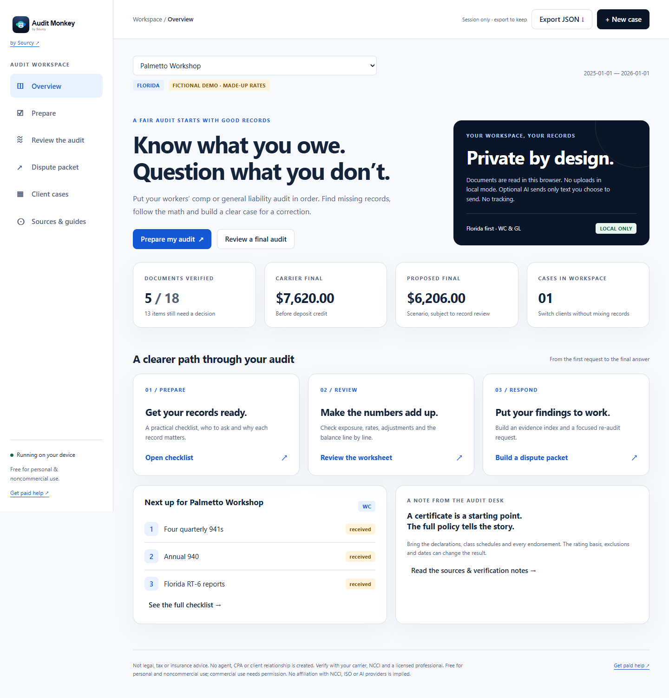

# The Audit Monkey

 


A free tool for preparing, reviewing and questioning workers’ compensation and general liability premium audits. Florida first, with a separate NCCI state module and a separate GL engine. Built for an insured’s audit preparation and staff case review, subject to the noncommercial licensing terms below.

**Keep the records. Follow the math. Ask for a supported correction.** A correction may lower additional premium or increase a return; it may also reveal that more premium is owed. No savings are guaranteed.

## Quick start

Use Node **22.13+ or 24+** and npm. From this repository’s root:

```sh
npm ci
npm run dev
```

Open the loopback address printed by Vite (normally `http://127.0.0.1:5173`). The first case is a clearly labeled fictional demo with made-up rates and class labels. Select **New case** for your own inputs. No keys or accounts are needed.

```sh
npm run lint
npm test
npm run build
npm run preview
```

The compiled static app is in `app/dist/`. These commands do not deploy anything. CI runs lint, type checking, all engine/MCP tests and the production build.

## What is included

- **Prepare:** 18 evidence categories covering the full policy, audit instructions, P&L, payroll registers, GL, four 941s, 940, Florida RT-6, W-2/W-3, 1099s, dated sub COIs, individual exemptions, overtime detail, officer limits, excluded pay/sales, mod worksheets and GL bases. Each identifies who to ask, what to obtain and why it matters. Carrier, accountant and subcontractor request drafts are downloadable.
- **Review:** local PDF text extraction with PDF.js or manual worksheet entry; WC and GL class rows; rate denominators; documented deductions; officer minimum/maximum and exemption checks; insured-sub treatment; mod effective periods; ordered credits, minimum premium, expense constants and assessments; deposit-versus-final reconciliation.
- **Findings:** verification gaps, manual class/basis/period questions, independently repriced adjustment estimates and an overall carrier-versus-proposed comparison. Effects may overlap and are not additive.
- **Respond:** a downloadable Markdown draft containing the cover letter, findings, evidence index, proposed worksheet, worksheet/re-audit requests and escalation notes. Nothing is sent or filed automatically. Deadline values remain TODO until confirmed for the policy.
- **Case workspace:** multiple clients, JSON export/import with schema validation, session-only operation by default, and optional unencrypted browser storage.
- **Guides:** original [prepare](guides/prepare.md), [review](guides/review.md), [dispute](guides/dispute.md), [WC](guides/wc.md), [GL](guides/gl.md), [Florida](guides/states/fl.md), [glossary](guides/glossary.md), [templates](guides/templates/README.md) and [AI prompts](prompts/README.md).
- **MCP:** an optional, separately launched local server exposing eight tools, seven public guide resources and a preparation prompt. See [client setup and provider requirements](mcp/README.md) for ChatGPT, Cursor, Claude, Gemini and Meta.

## Screenshots

All screenshots use fictional data and the approved assets from commit 39f12ed. See [brand provenance](brand/README.md).



<details>
<summary>Mobile workspace and editable review</summary>


</details>

## Privacy and limitations

With AI off, the **web app** has no backend, accounts, API keys, analytics, remote fonts or external data services. PDF text extraction uses a locally bundled worker. Documents and case data are not uploaded. External source/help/credit links open only when you choose them and do not include case data.

Cases remain in memory until you export JSON or enable **Remember cases on this browser**. Browser storage and exported files are unencrypted. Turning browser storage off removes that saved workspace; exported copies remain wherever you put them. The first-run acknowledgment is a separate small local preference. On a shared device, keep browser storage off and handle exports securely. No secrets or real customer data belong in this repository.

The **MCP process** is separate from the web app. It does not read browser cases, persist data or make outbound calls. A connected AI client sees supplied inputs and outputs and may send them to its provider. Read its privacy terms before sharing data. Stdio and a loopback-only Streamable HTTP development transport are implemented and tested. **No provider approval, public directory listing, remote deployment or consumer-chat integration is claimed.** ChatGPT public review requires a real hosted endpoint and other account/review requirements; Meta’s connector route has preview-program requirements. These are optional future publication steps, not blockers or requirements for this BYOK release.

PDF extraction reads text, not visual meaning. It does not infer class codes or automatically populate financial inputs. Scanned PDFs require separately performed OCR or manual entry. Limits: 25 MB / 200 PDF pages, 200,000 extracted characters, 5 MB JSON imports, 100 cases per imported workspace. Files that fail validation are rejected. The tool does not classify a business or decide insurance coverage.

Enter your own verified rates. No carrier rates, NCCI officer values, proprietary ISO tables or assumed Florida assessment percentages are shipped. Unknown values are **TODO**, not facts. The engine requires confirmation of the premium sequence and withholds final estimates for missing verification. Special programs, maritime/PEO issues, cancellation short-rate rules and unusual assessment bases may require separate reconciliation by a licensed professional. See [calculation behavior](docs/calculation-model.md).

## Architecture

```text
app/src/engine/       Pure typed WC, GL, premium-sequence and review functions
app/src/states/fl.ts  State interface implementation and primary source register
app/src/schema.ts    Shared JSON and MCP validation
app/src/main.ts      Accessible browser workspace
app/src/pdf.ts       Browser-only PDF.js text extraction
app/src/brand.ts     One brand asset/link configuration
app/src/tokens.css   Central color tokens
brand/               Source logo, favicon and provenance
mcp/                 Optional stdio / local HTTP server, protocol tests, client docs
guides/              CC BY-NC guides and request templates
prompts/             CC BY-NC copy-paste prompts
```

Source links include the [NCCI Basic Manual / Atlas](https://www.ncci.com/Pages/Atlas.aspx), [F.S. 440.381](https://www.leg.state.fl.us/statutes/index.cfm?App_mode=Display_Statute&URL=0400-0499/0440/Sections/0440.381.html), [Florida DWC](https://www.myfloridacfo.com/division/wc/employer/exemptions) and [ISO / Verisk background](https://www.verisk.com/4a5f82/siteassets/media/downloads/iso/paas/paas-professional-development-catalog.pdf). **Verify current values and policy-effective editions.** Some manuals require licensed access. This project does not redistribute them or imply affiliation.

## Validation and contributing

See [verification evidence](docs/verification.md), [browser report](docs/browser-verification.json) and [CONTRIBUTING.md](CONTRIBUTING.md). The math suite covers WC allocation, OT, officer limits, exemptions, uninsured-sub reversal, effective-date mods, GL bases, premium sequencing, proration, minimums and balance/return. MCP tests exercise initialization, discovery, calls, invalid inputs, resources/prompts, stdio and local HTTP Host/Origin enforcement.

Optional browser checks:

```sh
npx playwright install chromium
# In a separate terminal, run npm run dev first
npm run test:browser
```

For an installed browser, set `AUDIT_BROWSER_PATH` to its executable. Set `AUDIT_BASE_URL` if Vite uses another loopback port. The script uses fictional data and generates screenshots plus an axe WCAG 2.1 A/AA report. Automated scans do not establish complete WCAG conformance; manual keyboard and visual review remain necessary.

## Licenses and disclaimer

- Original code: [PolyForm Noncommercial 1.0.0](LICENSE).
- Original guides, prompts and templates: [CC BY-NC 4.0](guides/LICENSE), including `/prompts` and `/guides/templates`. Attribute The Audit Monkey, by Sourcy, link to the source/license and identify modifications.
- Free for personal and noncommercial use under those terms. **Commercial use needs permission**, including business/staff workflows where they constitute commercial use. “Free” is not a blanket commercial-use license. Contact [Sourcy](https://sourcyinc.com) for permission. Brand marks and third-party dependencies retain their respective rights; see [third-party notes](THIRD_PARTY_NOTICES.md).

**Not legal, tax or insurance advice. No agent, CPA or client relationship is created. Verify with your carrier, NCCI and a licensed professional.**

[by Sourcy](https://sourcyinc.com) · [Get paid help](https://theauditmonkey.com)

## Optional AI settings

AI is off by default. Under Sources & guides, enable it for this session, select OpenAI-compatible or Anthropic, enter your own endpoint, model ID and key, and review the exact selected text before pressing Send. Keys/settings stay only in memory: no hosted keys, saved keys, .env bundling or inclusion in JSON exports. Reload or Clear disables AI. Provider requests can cost money and send text to that provider. CORS/network/provider errors do not affect either local audit mode. No provider approvals or deployment are required for this release. MCP remains an optional local integration.

Documentation under docs/, guides/, prompts/ and templates is CC BY-NC 4.0; see docs/LICENSE and guides/LICENSE. The original code remains PolyForm Noncommercial 1.0.0.
