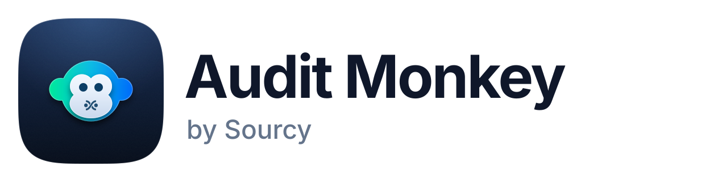
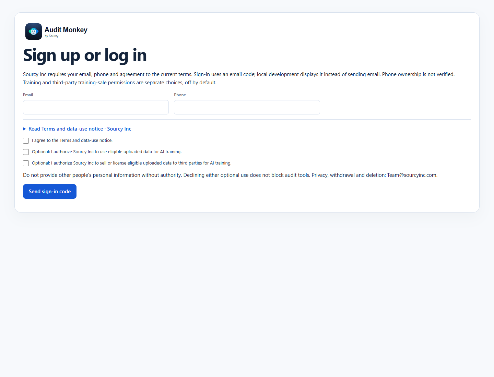
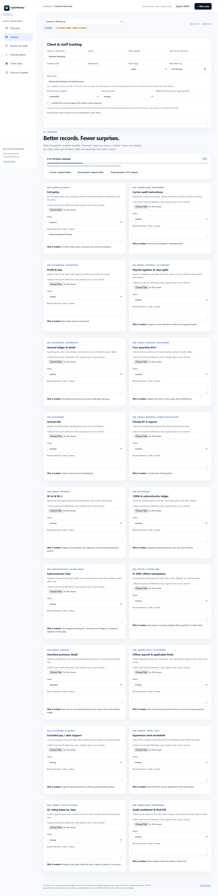
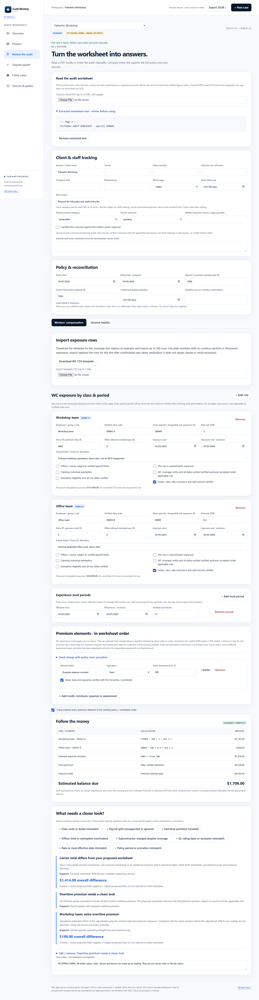
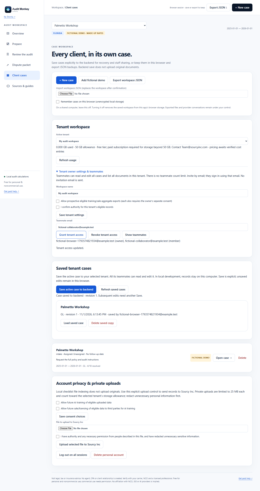
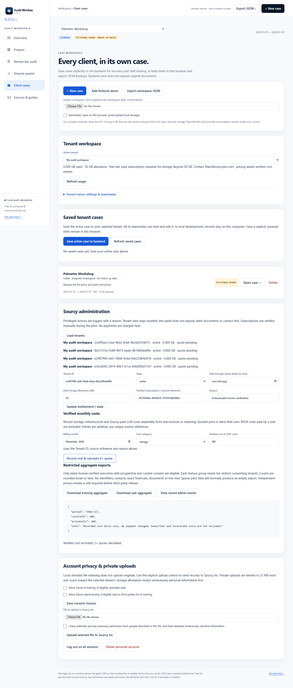
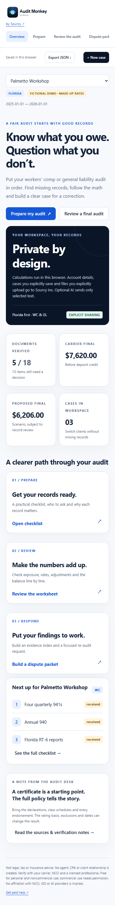

# The Audit Monkey

 



A Florida-first workers’ compensation and general liability premium-audit workspace, by [Sourcy](https://sourcyinc.com). Prepare records, find missing items, follow audit math and download an evidence-backed findings/dispute draft. No refund is guaranteed.

**MVP / local pilot:** tenant workspaces, unlimited teammates, WC/GL preparation and review, recoverable cases, printable dispute drafts and a Sourcy admin console. See the [employee pilot runbook](docs/pilot-runbook.md). Nothing has been deployed.

## One-command local run

Use Node 24 and npm. From this repository on initial-build:

```sh
npm start
```

Open **http://localhost:8787**. This performs npm ci, builds the static app, creates an ignored local development secret, applies local D1 migrations and launches the Cloudflare Worker with simulated D1/R2/KV. It creates no cloud resources and does not deploy.

Enter a fictional email, phone and accept the current terms. In local development only, the sign-in code is displayed in the browser; no email is sent. Development mode refuses public hostnames. Use fictional records only. The first audit case is a fictional demo with made-up rates/classes. New case starts your own worksheet. See [backend setup and limits](backend/README.md).

## Accounts, terms and privacy

The browser workspace now requires email, phone, current-terms acceptance and a sign-in code. The old disclaimer acknowledgment cannot bypass registration. In production, a configured email service must verify email ownership; phone ownership is not verified. Operator: **Sourcy Inc**. Privacy, withdrawal and deletion contact: **Team@sourcyinc.com**.

[Terms and data-use notice](app/src/terms.ts) plainly disclose optional AI-training and third-party training-sale/licensing uses. Those permissions are separate, unchecked choices, never inferred from accepting general terms or OAuth scopes. Declining them does not block audit tools. Restricted training/sale aggregate downloads are available only to allowlisted Sourcy admins, with prospective/current permissions, human-verified outcomes and small-group suppression. No buyer delivery, automatic model retraining or marketing pipeline is enabled. Permission cannot override employees’/subcontractors’ rights or legal restrictions. The terms and operational policies need legal review before public collection.

Tenant membership, saved cases, accounts, consent history and sessions are stored in D1; explicitly uploaded originals are private R2 objects. Local record indexing only records filenames in your case. **Only the separate Upload selected file to Sourcy Inc action transmits an original**, after authority/redaction confirmation. Private uploads are limited to 25 MB each and count toward tenant storage. Tenant teammates can download originals as attachments; other tenants cannot access them. No public file links are provided.

Privacy controls in Client cases let users change/withdraw optional permissions, delete uploaded originals, log out all website sessions or delete the account and active uploads. Account deletion also revokes OAuth grants; shared tenant owners must first remove teammate access. Departing members do not delete the tenant’s records. There is no automatic training or third-party transfer to undo. Future training/transfer practices, retention and infrastructure backup deletion must be finalized before launch. No promise that completed model training can be reversed is made.

Audit edits stay in browser memory unless you explicitly save the active case to the tenant backend, export JSON or enable unencrypted browser storage. Browser workspaces are scoped to both account and tenant. Backend cases use optimistic revisions to prevent silent overwrites. Tenant owners invite/revoke unlimited teammates by email; members share that tenant’s cases and documents. Lists paginate, with no per-seat cap. Local JSON/browser copies remain independent of backend deletion. Avoid browser storage on shared devices and protect exports. No real customer data or secrets belong in this repository.

## Both audit modes work without AI

- **Prepare:** full-policy, audit-instructions, P&L, payroll, GL, four 941s, 940, RT-6, W-2/W-3, 1099, sub COI, individual exemption, OT, officer-cap, excluded-pay/sales, mod and GL-basis checklist. Each item explains where to obtain it, who to ask and its potential effect. Statuses distinguish missing/requested/received/verified/not applicable. Request-letter downloads are included.
- **Review:** browser PDF.js text extraction or manual entry; WC/GL class/exposure rules, explicit rates and denominators, documented OT premium, officer minima/maxima and exemptions, insured-sub adjustments, mod periods, premium steps, minimums, assessments, proration checks and deposit-versus-final balance.
- **Respond:** downloadable Markdown and printable HTML findings, evidence index, proposed worksheet and dispute/re-audit letter draft. Open HTML in a browser and Print → Save as PDF. Pre-submission checks cover evidence references, policy identity, calculation, deadline and reviewer. Nothing is submitted automatically. Carrier/re-audit/NCCI WC/DFS/OIR routes are documented; unknown deadlines remain TODO.
- **Cases:** staff assignment, work stage, follow-up, internal notes, carrier outcomes, schema-validated JSON export/import, tenant backend save/recovery, conflict detection and isolated optional browser storage. Internal notes are excluded from carrier drafts.
- **Guides:** [prepare](guides/prepare.md), [review](guides/review.md), [dispute](guides/dispute.md), [WC](guides/wc.md), [GL](guides/gl.md), [Florida](guides/states/fl.md), [glossary](guides/glossary.md), [templates](guides/templates/README.md), [AI prompts](prompts/README.md).

PDFs extract text only: financial inputs must be verified and entered manually or imported through the WC/GL CSV templates. CSV imports replace the selected line’s rows and clear verification; they do not infer classes, coverage or exclusions. Scans need separate OCR. The tool does not independently decide classifications, coverage, authority or an allowed exclusion. Enter verified policy rates; no carrier rates or proprietary NCCI/ISO tables are shipped. Caps, assessment values and deadlines remain TODO until verified. See [calculation model](docs/calculation-model.md).

## Tenant storage, billing and learning

Each tenant receives 50 decimal GB (50,000,000,000 bytes) of logical case/file storage. Atomic database triggers track changes and reject additional storage when a paid allowance is required. Existing reads and deletions remain available. During the pilot, allowlisted Sourcy admins verify subscriptions externally and record paid-through dates, allowances and invoice references; **no automatic checkout or charges exist**. The cost ledger records verified monthly storage, infrastructure and Sourcy-paid LLM costs; the quote is exactly 2× recorded costs. BYOK charges paid by users are excluded. No provider prices, unrecorded costs, taxes or fees are guessed.

Every saved case revision creates an atomic structured learning event. Human verification and written carrier outcome references distinguish reviewed outcomes from drafts. Only prospective and current permissions qualify for exports, with at least ten distinct consenting tenants per group and counts rounded down to tens. Export fields are coverage, broad row-count band, review category, outcome and counts. No identifiers, contacts, exact financial values, rates, documents, free text or dates are exported. These controls are not a legal anonymization determination. No model automatically retrains or changes audit rules.

## Optional BYOK AI

AI is off by default. Under Sources & guides select OpenAI-compatible or Anthropic, enter your own endpoint/model/key, review selected text, then press Send. Keys/settings stay in session memory, are not hosted, saved or exported, and clear on reload. Provider calls may incur charges and send selected text under that provider’s terms. They are separate from Sourcy Inc's training/sale permissions. No background provider requests occur. Provider/CORS errors leave local audit tools available.

## MCP login and compatibility

The same eight engine/guide tools are available through a separately launched stdio server or the Worker’s authenticated /mcp endpoint. The remote endpoint uses Cloudflare’s maintained OAuth provider: OAuth discovery, protected-resource metadata, authorization code with S256 PKCE, DCR/CIMD support, exact resource audience, browser-bound Allow/Deny consent, issuer responses, refresh rotation and revocation. Website login supplies user identity; clients receive scoped OAuth tokens, never the website session cookie. audit:read grants calculations/public guides, not contacts, private uploads, training or sales rights.

```sh
npm run mcp:stdio
```

[MCP client configuration](mcp/README.md) and [backend authentication notes](backend/README.md) distinguish implementation from actual host acceptance. ChatGPT, Claude, Cursor and Gemini have documented remote OAuth/MCP flows. Muse here means Meta Muse Code: MCP support is documented, but its exact remote OAuth acceptance contract is not verified. Local stdio remains available. No provider certification, public listing or real-client acceptance is claimed. Cloud-hosted clients need an approved reachable HTTPS endpoint or supported tunnel; localhost alone is not a public ChatGPT connector. Nothing has been deployed.

## Screenshots · fictional data



<details><summary>Before and after audit</summary>







</details>

## Development and checks

```sh
npm ci
npm run lint
npm test
npm run build
npm run build:api
npm run dev:api
```

npm test builds the app and a dry-run Worker bundle first, then runs engine, provider, registration, actual stdio/HTTP and isolated D1/R2/OAuth tests. No remote credentials or actual emails are used. For browser verification run the local Worker first, then set AUDIT_BASE_URL=http://localhost:8787 and run npm run test:browser. Set AUDIT_BROWSER_PATH to an installed Chrome executable or install Playwright Chromium. Tests and screenshots use fictional data.

[Verification evidence](docs/verification.md) · [verbose output](docs/test-output.txt) · [browser report](docs/browser-verification.json) · [CONTRIBUTING](CONTRIBUTING.md). CI performs lint/type checks, all tests, builds and isolated browser workflows for staff and Sourcy administration. Automated axe checks plus focused keyboard/mobile inspection are not comprehensive accessibility certification.

The app and pure engine are under app/src; state rules/sources are in app/src/states/fl.ts; backend/ contains Worker/D1/R2/OAuth code; mcp/factory.ts is shared by transports; branding uses app/src/brand.ts and app/src/tokens.css. [Approved assets](brand/README.md) are from commit 39f12ed.

## Licenses and source notes

Original code: [PolyForm Noncommercial 1.0.0](LICENSE). Original docs/guides/prompts/templates: [CC BY-NC 4.0](docs/LICENSE), also at [guides/LICENSE](guides/LICENSE). Free for personal and noncommercial use; commercial use needs permission. Attribute The Audit Monkey, by Sourcy, link to source/license and identify changes. Third-party dependencies and brand marks retain their rights; see [notices](THIRD_PARTY_NOTICES.md).

Verify current values and policy-effective editions using the [NCCI Basic Manual/Atlas](https://www.ncci.com/Pages/Atlas.aspx), [F.S. 440.381](https://www.leg.state.fl.us/statutes/index.cfm?App_mode=Display_Statute&URL=0400-0499/0440/Sections/0440.381.html), [Florida DWC](https://www.myfloridacfo.com/division/wc/employer/exemptions) and the applicable ISO/manual rules through your licensed professional. Proprietary manuals are not redistributed.

**Not legal, tax or insurance advice. No agent, CPA or client relationship is created. Verify with your carrier, NCCI and a licensed professional.**

[by Sourcy](https://sourcyinc.com) · [Get paid help](https://theauditmonkey.com)
